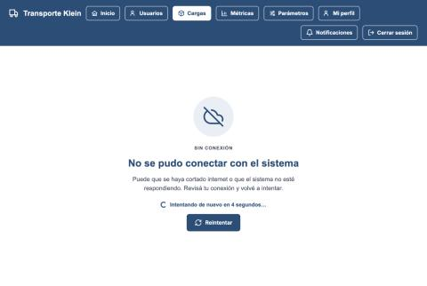
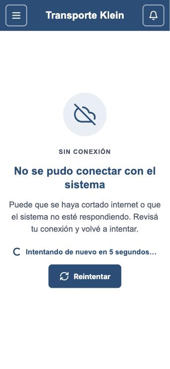
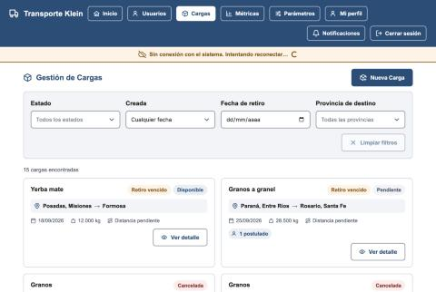
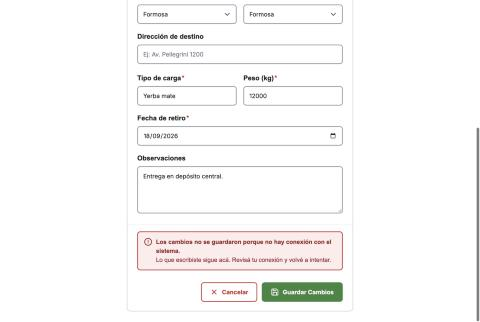

# Sin conexión con el sistema: verificación

Cómo se comporta el sistema cuando no puede comunicarse con el backend. Hay
tres casos, según lo que estaba haciendo el usuario:

| Situación | Qué se ve |
|---|---|
| Entra a una pantalla (o cambia de sección) y sus datos no llegan | La pantalla entera se reemplaza por "No se pudo conectar con el sistema", con la barra superior y el botón **Reintentar**. |
| Toca un botón de acción (guardar, cancelar, postularse, asignar…) | Aviso al lado del botón: "*Lo que no pasó* porque no hay conexión con el sistema." La pantalla y lo escrito quedan como estaban. |
| Se corta con la pantalla ya cargada | Franja amarilla debajo de la barra: "Sin conexión con el sistema. Intentando reconectar…". No tapa nada. |

Cómo funciona:

- Las lecturas (GET) se reintentan solas dos veces, al segundo y a los 3
  segundos, antes de dar el pedido por perdido. Un corte corto no llega a
  verse. Las acciones no se reintentan solas: si el pedido llegó y se perdió
  la respuesta, repetirlo podría, por ejemplo, registrar la carga dos veces.
- Cuenta como falta de conexión un `fetch` que falla y también un 502, 503 o
  504, que es lo que responde Railway cuando el backend no contesta.
- Con la pantalla de error o la franja a la vista, el sistema prueba solo si
  volvió (`GET /health`) a los 5, 10, 20 y después cada 30 segundos (la espera
  crece al doble, con tope). También prueba enseguida cuando el navegador
  avisa que recuperó internet. Tocar **Reintentar** prueba en el momento y no
  alarga la espera siguiente. Cuando vuelve, la franja se va y la pantalla se
  carga sola.
- Si una pantalla ya mostró sus datos y falla una recarga (otro filtro, otro
  período, "Mostrar más"), el aviso va en la misma pantalla y no la reemplaza.
- La franja la dispara la consulta del contador de notificaciones, que corre
  cada 30 segundos, o el aviso del navegador de que se quedó sin internet.
- El login queda afuera: el error se muestra en el formulario, con el mismo
  texto que el resto ("No se pudo ingresar porque no hay conexión con el
  sistema. Revisá tu conexión y volvé a intentar.").

El código está en `src/api/conexion.js` (reintentos y `/health`),
`src/utils/conexion.js` (reglas puras, con tests en `tests/conexion.test.js`),
`src/components/ControlConexion.jsx` (la ruta que envuelve las pantallas con
sesión), `PantallaSinConexion`, `AvisoSinConexion` y la franja de
`BarraSuperior`. Cada pantalla avisa su falta de conexión con
`useAvisoSinConexion`.

## Verificación en el navegador

Contra la API y la base locales, con un backend propio en el puerto 3100 que
se apagó y se prendió durante la prueba.

| Comprobación | Resultado |
|---|---|
| Administrador, backend apagado, toca "Cargas" en la barra | "Cargando…" unos 3 segundos y después la pantalla de "Sin conexión", con "Cargas" marcado en la barra. |
| Cuenta regresiva | "Intentando de nuevo en N segundos…", que baja de a uno. |
| Reintentar con el backend apagado | Prueba en el momento y vuelve a la cuenta, sin alargar la espera. |
| Se prende el backend | A los pocos segundos la pantalla se carga sola (15 cargas). |
| Con el listado a la vista, se apaga el backend | A los 3 segundos aparece la franja y el listado sigue a la vista. |
| Se prende el backend | La franja se va sola a los 4 segundos. |
| Editar carga, backend apagado, "Guardar Cambios" | "Los cambios no se guardaron porque no hay conexión con el sistema. Lo que escribiste sigue acá. Revisá tu conexión y volvé a intentar.", arriba de los botones; el formulario conserva los datos. |
| Lo mismo en el celular | El aviso queda arriba de los botones, que se apilan. |
| Pantalla de "Sin conexión" en el celular (375 px) | Sin desplazamiento horizontal; Reintentar con su ancho normal. |
| Camionero, backend apagado, "Mis viajes" desde el menú | Pantalla de "Sin conexión". |
| Con el backend prendido, administrador y camionero | Las pantallas cargan como antes. |
| Consola del navegador | Solo los `ERR_CONNECTION_REFUSED` de los pedidos que fallan; sin errores de React. |

`npm test` (57 tests) y `npm run build` pasan. `npm run lint` sigue sin poder
ejecutarse por la falta de configuración de ESLint.

